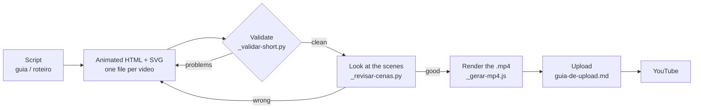

# fermentation-shorts

**A faceless YouTube channel about home fermentation — built entirely in HTML + SVG.**

Every video on this channel is hand-coded: animated SVG scenes in a self-contained
HTML file, recorded from the screen, edited and published. No stock footage, no
camera, no face. Just hands, vegetables, salt and time.

This repository is the production workspace behind it — the animations, the
renderers, the validators, the covers and the whole publishing plan.

[](https://github.com/FLORMATTER/fermentation-shorts/actions/workflows/validate.yml)
[](LICENSE)
[](#how-a-video-gets-made)
[](#the-catalogue--28-entries)

---

## What this is

A series of short vertical videos (1080×1920) that explain how to ferment a
vegetable with nothing but salt, water and a jar. Each video is one vegetable,
one idea, under 60 seconds, in English.

The channel targets an **international audience** — home fermentation barely
performs in Portuguese-language markets, so every on-screen text, title,
description and cover is in English. The production notes and the planning
documents are kept in Portuguese.

There are **28 catalogued entries**: 27 Shorts and one 16:9 long-form video.
All 27 Shorts are already rendered to `.mp4`.

---

## How a video gets made



The product of this repository is **not** the video. It is the animated HTML
file that gets recorded. That has always been the model and it has not changed —
the `.mp4` files here are a convenience, not the source of truth.

---

## Repository layout

| Path | What is in it |
|---|---|
| `alho/` `beterraba/` `brocolis/` `cebola/` `cenoura/` `cores/` `couve-flor/` `kombucha/` `mosquito/` `pao/` `pepino/` `rabanete/` `repolho/` | One folder per vegetable / ferment. Each holds the animated HTML sources (English `-en` and Portuguese) and, where rendered, the `.mp4`. |
| `guia-geral/` | The **pillar** short — "the 5 easiest ferments" (#11). Opens the series. |
| `video-longo/` | The 12-minute 16:9 long-form video: player, script and publishing package (#13). |
| `aulas/` | Four introductory lessons on HTML, CSS, animations and the scene JavaScript. |
| `guias/` | The operating manual: recording, editing, uploading, the 18-week posting plan, titles/descriptions/hashtags, on-screen text. |
| `capas-canva/` | Cover images (1080×1920), plus the OpenCV pipeline that removed the burned-in Portuguese text and rebuilt the background. |
| `_base/` | Technical SVG drawings of the vegetables — the visual reference. |
| `_revisao/` | Contact sheets produced by `_revisar-cenas.py`. **Generated, gitignored.** |
| `_mp4/` | The MP4 renderer's own tooling and notes. |
| `_arquivo/` | Old material and archived manual backups. Not part of the current series. |
| `_teste-rec/` | Chrome profiles used while testing the OBS recording flow. **Gitignored.** |
| `galeria-shorts.html` | A clickable gallery of every short — the visual index of the series. Regenerate with `python _gerar-galeria.py`. |
| `_*.py`, `_*.js` | The tooling. Prefixed with `_` so they sort away from the content folders. |

> **A new video goes into three places:** its folder, the publishing package
> (`guias/pacote-legendas-descricoes-en.md`) plus the posting plan
> (`guias/plano-de-postagem.md`), and the gallery (which scans the folders).

---

## The catalogue — 28 entries

The authoritative, entry-by-entry table lives in
**[`guias/pacote-legendas-descricoes-en.md`](guias/pacote-legendas-descricoes-en.md)**
under *"WHICH FILE TO RECORD"*. Summary:

| # | Entry | File to record | .mp4 |
|---|---|---|---|
| 1 | Sauerkraut (pillar) | `repolho/shorts-chucrute-30s-en.html` | yes |
| 2 | Cabbage | `repolho/shorts-repolho-maos-canva-en.html` | yes |
| 3 | Beetroot | `beterraba/shorts-beterraba-svg-puro-en.html` | yes |
| 4 | Beetroot + watermelon | `beterraba/shorts-beterraba-melancia-en.html` | yes |
| 5 | Cauliflower | `couve-flor/shorts-couveflor-animado-en.html` | yes |
| 6 | Cucumber | `pepino/shorts-pepino-speed-en.html` | yes |
| 7 | Radish | `rabanete/shorts-rabanete-animado-en.html` | yes |
| 8 | Beetroot + kale | `beterraba/shorts-beterraba-couve-en.html` | yes |
| 9 | Garlic honey | `alho/shorts-garlic-honey-en.html` | yes |
| 10 | Red onion | `cebola/shorts-cebola-beterraba-en.html` | yes |
| 11 | General guide (pillar) | `guia-geral/shorts-5-easiest-en.html` | yes |
| 12 | Carrot | `cenoura/shorts-cenoura-animado-en.html` | yes |
| 13 | Long-form (7 vegetables) | `video-longo/player-video-longo-7-legumes-en.html` | **no** |
| 14 | 3 colours (garlic, onion, beetroot) | `cores/shorts-3-colors-en.html` | yes |
| 15 | Broccoli + orange | `brocolis/shorts-broccoli-orange-en.html` | yes |
| 16 | DIY mosquito trap *(side track)* | `mosquito/shorts-mosquito-trap-en.html` | yes |
| 17 | Cucumber + apple | `pepino/shorts-pepino-apple-en.html` | yes |
| 18 | Carrot + apple | `cenoura/shorts-carrot-apple-en.html` | yes |
| 19 | Beetroot + garlic | `beterraba/shorts-beet-garlic-en-1080x1920.html` | yes |
| 20 | Cauliflower + apple | `couve-flor/shorts-cauliflower-apple-en.html` | yes |
| 21 | Sourdough starter | `pao/shorts-sourdough-en.html` | yes |
| 22 | Cucumber + garlic | `pepino/shorts-cucumber-garlic-en.html` | yes |
| 23 | Watermelon + apple kombucha | `kombucha/shorts-watermelon-apple-en.html` | yes |
| 24 | Apple + melon kombucha | `kombucha/shorts-apple-melon-en.html` | yes |
| 25 | Beetroot + carrot | `beterraba/shorts-beet-carrot-en.html` | yes |
| 26 | Beetroot + watermelon kombucha | `kombucha/shorts-beet-watermelon-en.html` | yes |
| 27 | Apple + garlic + carrot | `cenoura/shorts-apple-garlic-carrot-en.html` | yes |
| 28 | Beet kvass with garlic | `beterraba/shorts-beet-kvass-garlic-en.html` | yes |

**⚠️ Variants — never post the same vegetable twice.** A few vegetables have a
second render in a different visual style (same facts, same numbers, same
script): cabbage (`shorts-repolho-animado`) and beetroot
(`shorts-beterraba-animado`, `shorts-beterraba-camadas`). Post **one per
vegetable** in the first round.

---

## Quick start

**Requirements**

| Tool | Needed for |
|---|---|
| [Google Chrome](https://www.google.com/chrome/) | `_gerar-mp4.js` drives it headlessly to draw every frame. |
| Python 3.9+ | Every `_*.py` script. The validators need nothing but the standard library. |
| Node.js 18+ | `_gerar-mp4.js`. It uses only built-in modules — there are no npm dependencies. |
| Pillow, NumPy, OpenCV | Only the image tooling (cover cleaning, contrast measurement). |

```bash
git clone https://github.com/FLORMATTER/fermentation-shorts.git
cd fermentation-shorts

# Optional — only needed for the image tooling
python -m venv .venv
.venv/Scripts/pip install -r requirements.txt   # Windows
# .venv/bin/pip install -r requirements.txt     # macOS / Linux
```

**Open the gallery** to see everything at once: open `galeria-shorts.html` in a
browser and click through.

**Render a short to `.mp4`:**

```bash
node _gerar-mp4.js --w=1080 --fps=30 --kbps=3000 --cfr=1 alho/shorts-garlic-honey-en.html
```

The driver retimes the file, renders it through headless Chrome and checks the
duration itself. Budget about twice the video's length.

```bash
node _gerar-mp4.js --todos --lista   # what is still missing, with an estimate
node _gerar-mp4.js --todos           # render everything that is missing
```

The batch command deliberately skips the Portuguese originals and the
`-1080x1920` style variants — those are the same video in another language or
another look, and posting both is the "inauthentic content" risk.

---

## Before delivering any animated file

### 1. Validate

```bash
python _validar-short.py                                       # the whole project
python _validar-short.py guia-geral/shorts-5-easiest-en.html    # a single file
```

It prints `TOTAL DE PROBLEMAS: 0` when the file is clean, and exits non-zero
otherwise. It checks:

| Check | Why it matters |
|---|---|
| `animations: N \| keyframes: M` | **Never trust an empty result without reading the counts** — two empty lists report "0 errors" but may mean *no keyframe exists at all* and the video is frozen. |
| `url(#x)` with no matching `id` | Each `<svg>` is a separate document; it does not inherit `<defs>` from another. |
| `@keyframes` never used | Dead weight, harmless, worth cleaning. |
| Corrupted hex colour | The generator occasionally writes `#8b8köln`. |
| `svg id` ≠ `scenes[].id` | If they disagree the scene never appears and the screen stays black. |
| **`transform=` + an animation on the same tag** | 🔴 The animation **replaces** the `transform` attribute and the element jumps to the origin (0,0). |
| **`<text>` inside a `<rect>`** | 🔴 A `<rect>` is **not** a container in SVG — the text is never drawn. The card appears empty, with no error. |
| **Keyword `transform-origin`** | 🔴 In SVG it resolves against the **viewBox** (405×720), not the drawing. |
| Text below `y=645` | It hides behind the caption bar. |

> The two files under `video-longo/` report a **false positive**: the validator
> assumes a 405×720 card, but that is a 16:9 player, and its CSS variables
> (`#cap`, `#cbar`, …) look like suspicious hex colours.

**Fixing the `transform=` bug in bulk** — wrap each `<g>` in an outer `<g>` that
carries the transform, preserving line endings and touching nothing else:

```bash
python _consertar-transform.py            # dry run: shows what it would do
python _consertar-transform.py --apply    # writes
```

### 2. **Look** at the scenes

This is the step that greps cannot do.

```bash
python _revisar-cenas.py guia-geral/shorts-5-easiest-en.html
python _revisar-cenas.py alho/shorts-garlic-honey-en.html --no-anim
```

It builds a contact sheet of every scene at native size and renders it to PNG
in `_revisao/`. The caption bar is **marked in red** so you can see whether
anything strayed into it.

| Flag | What it does | When to use it |
|---|---|---|
| `--final` | freezes each animation at its **last** frame | ✅ **this is the mode for reviewing layout** |
| `--no-anim` | strips the animations (base style) | only to prove the `transform=` bug |
| `--cols N` | N scenes per row | see all 8 scenes at once (`--cols 8`) |

> ⚠️ **Without `--final` the sheet is rendered at t=0** and every element using
> `animation-fill-mode: both` looks **invisible** — it seems the text vanished,
> but it is just the first frame. `--virtual-time-budget` does **not** advance
> the CSS animation timeline under `--headless=new`; `--final` does, by
> injecting `animation-delay:-1s` + `animation-play-state:paused`.

To check the **real 1080×1920 frame** (with the HTML caption bar on top):

```bash
python _captura-upload.py beterraba/shorts-beet-garlic-en-1080x1920.html --cenas 0,6
```

---

## The two SVG bugs that keep coming back

### 🔴 `transform=` + `animation` on the same tag

```html
<!-- WRONG: the animation erases translate(202,372) -->
<g transform="translate(202,372)" style="animation:floatUpDown 3.4s infinite"> … </g>

<!-- RIGHT: the transform on the outer <g>, the animation on the inner one -->
<g transform="translate(202,372)">
  <g style="animation:floatUpDown 3.4s infinite"> … </g>
</g>
```

In SVG, `transform` is a **presentation attribute** — a CSS declaration
(including one coming from an animation) **wins** over it. So any element with
`transform="…"` **and** an animation touching `transform` is drawn at the SVG
origin instead of where it was placed. The symptom: the subject disappears from
the centre and a piece of it shows up clipped in the top-left corner.

Found in **12 of 13** shorts. It was fixed on 2026-09-15 — 69 elements across 11
files, via `_consertar-transform.py --apply`.

**How to check:** render the file, then render it again with `--no-anim`. If the
two images differ, this is the bug.

### 🔴 Keyword `transform-origin`

In SVG, `transform-origin` is **not** resolved against the element's own box —
it is resolved against the **viewBox** (here 405×720):

| Written | Becomes (local coordinates) | OK? |
|---|---|---|
| *(nothing — the default)* | `0 0`, the element's own origin | ✅ **correct** |
| `transform-origin:0 0` | `0 0` | ✅ |
| `transform-origin:202px 176px` | `202, 176` | ✅ if that is what you want |
| `transform-box:fill-box; transform-origin:50% 50%` | centre of the **drawing itself** | ✅ |
| `transform-origin:center` | `202.5, 360` | ❌ pivot far from the drawing |
| `transform-origin:center top` | `202.5, 0` | ❌ |
| `transform-origin:center bottom` | `202.5, 720` | ❌ |
| `transform-origin:left` | `0, 360` | ❌ |

Symptom: the knife **rotates around a point outside the frame** instead of
cutting in place, the clock hand **leaves the dial**, the massaging hand scales
away. The bug only shows up when the keyframe contains `rotate` or `scale`,
which is why the validator only flags it in that case.

**Fix:** replace the keyword with `0 0`. The pivot becomes the element's local
origin, which is where the drawing was built.

---

## Documentation index

| Document | What it covers |
|---|---|
| [`guias/plano-de-postagem.md`](guias/plano-de-postagem.md) | The **18-week posting plan**, video by video, with the exact file to open. |
| [`guias/guia-de-upload.md`](guias/guia-de-upload.md) | Publishing to YouTube — field by field, with what to paste where. |
| [`guias/guia-obs-passo-a-passo.md`](guias/guia-obs-passo-a-passo.md) | Installing and configuring OBS from scratch. |
| [`guias/guia-capcut-pc.html`](guias/guia-capcut-pc.html) | Editing in CapCut on the PC. |
| [`guias/pacote-legendas-descricoes-en.md`](guias/pacote-legendas-descricoes-en.md) | Titles, descriptions and hashtags for every video, plus the *"WHICH FILE TO RECORD"* table. |
| [`guias/textos-de-tela-capcut-en.md`](guias/textos-de-tela-capcut-en.md) | The on-screen text to overlay in CapCut (hook / middle / close). |
| [`guias/como-ganhar-dinheiro.md`](guias/como-ganhar-dinheiro.md) | How the channel makes money, and the honest timeline. |
| [`guias/como-virar-video-de-verdade.md`](guias/como-virar-video-de-verdade.md) | Turning an animated file into a finished video. |
| [`aulas/`](aulas/) | HTML, CSS, animations and scene JavaScript — from zero. |
| [`guia-geral/como-gravar-e-publicar.md`](guia-geral/como-gravar-e-publicar.md) | Recording in the native 1080×1920 format via an OBS Browser Source. |

---

## Rules that do not change

| Rule | Why |
|---|---|
| **Always iodine-free salt** | Iodine kills the ferment. The vegetable rots instead of fermenting. |
| **Fuzzy coloured mould = throw it all out** | No debate. Bubbles and a sour smell, on the other hand, are normal. |
| **Garlic may turn blue or green** | A natural sulphur reaction. **It is not mould.** Do not throw it out. |
| **No face in frame** | It is the channel's identity. Hands may appear — both of them at once, even better. |
| **Only YouTube's audio library** | CapCut's library usually triggers copyright claims. |
| **Text in English** | The target audience is international. Covers, captions and CTAs in English. |
| **CapCut on PC** | Windows + OBS + CapCut PC. |

---

## Money, honestly

**Shorts do not monetise** — watch time on Shorts does not count toward the
4,000 hours required. The long-form video is the path to monetisation, and the
bar doubles on **1 January 2027**. Nothing has been published yet.

Full detail: [`guias/como-ganhar-dinheiro.md`](guias/como-ganhar-dinheiro.md).

---

## Project status

| | |
|---|---|
| Catalogued entries | **28** (27 Shorts + 1 long-form) |
| Rendered to `.mp4` | **27 of 28** — only the long-form (#13) is pending |
| Publishing plan | 18 weeks, written |
| Published | **nothing yet** — channel and name not chosen |
| OBS | not installed |

**Left to do:** record, edit and publish. Portuguese versions of #4 and
#22–#28 are also still missing.

---

## Contributing

See [`CONTRIBUTING.md`](CONTRIBUTING.md). The short version: run the validator,
**look at the rendered scenes**, and never trust a grep for layout, colour or
shape.

## License

The **code** is [MIT](LICENSE). The **creative content** — rendered videos,
cover images, scripts, titles and descriptions — is © 2026 Flor Finetti, all
rights reserved. See the note at the end of [`LICENSE`](LICENSE).

---

<sub>Português? Leia [`README.pt-BR.md`](README.pt-BR.md).</sub>
